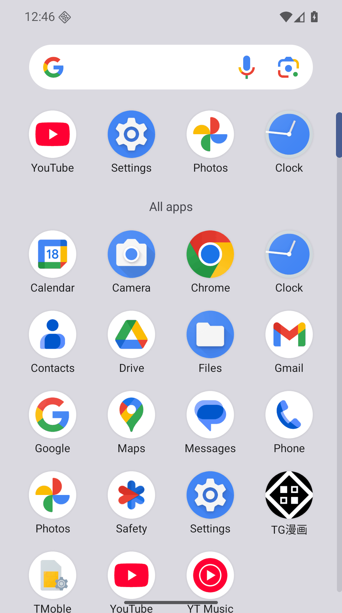

# TG漫画（TGComicReader）2.0

一个只管一件事的安卓漫画阅读器：**吃 telegra.ph 链接，出书架 + 阅读器 + 可导出的链接记录**。
2.0 版整体重做了视觉与布局 —— **液态玻璃（Liquid Glass）材质**，并补了一批实际操作里最缺的功能。

针对的内容形态（实测样本 `docs/sample-page.html`）：
`https://telegra.ph/...---Page-1-11-17`
正文 `<article id="_tl_editor">` 里一串 ``（Telegram file_id 形态的图床地址，**没有文件扩展名**）。

---

## 2.0 做了什么

### 液态玻璃材质（纯自绘，零新依赖）
`Glass.kt` 里一套材质令牌与组件：

| 元素 | 实现 |
|---|---|
| 背景 | 极光层：青 / 紫 / 粉 / 蓝四色径向光斑 + 上下压暗渐变，静态渲染（省电、避免大尺寸合成问题） |
| 玻璃面 | `Modifier.liquidGlass()`：斜向白渐变体 + 双色折射叠加 + 高光扫掠 + 内部暗影 + 1.2dp 渐变描边 + 光晕阴影 |
| 按钮 / 胶囊 / 分段器 | `GlassPill`、`GlassSymbolButton`、`GlassSegmented`、`GlassFab`、`GlassBar` |
| 大面板（菜单 / 对话框） | 不透明深色三段渐变 + 1px 渐变描边（避免大尺寸半透明渐变的渲染异常，视觉仍是深玻璃） |
| 空状态 | 自绘"叠纸 + 光晕"插画 `EmptyState` |
| 进度 | `ProgressRing` 环形缓存进度、`MiniProgress` 渐变阅读进度 |

### 布局重排
- 顶栏：大标题 + 实时统计（册数 / 链接数）+ 排序、视图、更多三颗玻璃球
- 分段器「书架 / 链接记录」+ 玻璃搜索条
- 书架支持**列表 / 网格**两种排版，网格 2/3 列可切
- 卡片：圆角封面、收藏星、缓存进度环、渐变进度条、`⋯` 单册菜单
- 阅读器：顶部玻璃条（返回 / 标题 / 页码 / 收藏 / 更多）+ 底部玻璃条（可拖进度、缓存、亮度）
- 弹层全部改为同窗口 overlay（玻璃能透出背后的极光与卡片），并接管返回键

---

## 功能清单

| 需求 | 实现 |
|---|---|
| 解析 telegra.ph 链接 | `Parser.kt`：只取 `<article>` 内的 ``，兼顾 `<a href="*.jpg">`、`og:image` 兜底；页面内"下一页"自动跟页（最多 4 跳） |
| 复制后打开自动识别 | `onResume` 读剪贴板 → 识别链接（已入库的跳过）→ 弹窗一键导入 |
| 分享自动存列表 | `ACTION_SEND(text/plain)` + `ACTION_VIEW(telegra.ph)` 双入口，入库同时写一条链接记录 |
| 书架 | 列表 / 网格双视图、收藏置顶、四种排序（最近阅读 / 最近添加 / 标题 / 页数）、标题与作者搜索 |
| 多选批量 | 长按进入多选：全选、批量缓存、批量导出、批量删除 |
| 单册菜单 | 收藏、重命名、继续阅读、缓存整册、清除缓存、复制来源链接、导出本册 TXT、删除 |
| 阅读器 | 连续滚动 / 左右翻页双模式、双击放大（可双指缩放拖动）、可拖进度条跳页、三种底色（纯黑 / 纸白 / 护眼）、亮度三档、长按存图、点击隐藏界面 |
| 离线 | 整册缓存到 `filesDir/comics/<id>/0000.img …`，可随时取消，带环形进度 |
| 链接记录 | 状态点（已入书架 / 已合并 / 已存在 / 失败）、复制、单条重试、批量重试失败项、清空 |
| 导出 | 书架 JSON / 书架 TXT（含全部图片直链）/ 纯链接列表 / 仅导出所选，落 `Download/TGComic/` |
| 持久化 | `filesDir/library.json` + `SharedPreferences`（视图模式、列数、排序、阅读方向、底色、收藏优先） |

同一册的多页帖子（`... - Page 1`、`... - Page 2` …）按"去掉页码后的标题"**自动合并进同一册**。

---

## 构建

```bat
:: 需要 JDK 17+ 与 Android SDK（platform-35 / build-tools 35.0.0）
set JAVA_HOME=C:\Program Files\Microsoft\jdk-21.0.8.9-hotspot
gradlew.bat assembleDebug
:: 产物: app\build\outputs\apk\debug\app-debug.apk
```

工程路径含中文时 `gradle.properties` 已带 `android.overridePathCheck=true`；换机器改 `local.properties` 的 `sdk.dir`。
依赖只有 Compose + Coil（图片加载），没有 Room / Jsoup / OkHttp / 模糊库。

装：
```bat
adb install -r TGComicReader-2.0.apk
```

## 代码地图

```
app/src/main/java/com/lcs/tgcomic/
  Glass.kt       液态玻璃材质 + 极光背景 + 基础控件（Pill/Segmented/Fab/Bar/ProgressRing/EmptyState）
  Theme.kt       色板与排版令牌
  App.kt         根组件、状态模型（ImportState/CacheState/ExportKind）、剪贴板与页面模型工具
  ShelfScreen.kt 书架（列表/网格/搜索/排序/多选/单册菜单入口）+ 链接记录页
  ReaderScreen.kt 阅读器（连续/翻页、缩放层、进度、底色、亮度）
  Dialogs.kt     玻璃弹层：底部菜单、确认、重命名、导入预览（可勾选）、剪贴板、粘贴
  Model.kt       数据模型 + JSON 持久化 + 排序/收藏/缓存/导出 + Prefs
  Parser.kt      telegra.ph HTML 解析（正则，零第三方依赖）
  Net.kt         HttpURLConnection 抓页 / 下图（UA、重试、编码兜底）
  MainActivity.kt 剪贴板、分享 Intent、导入状态机、整册缓存（可取消）、相册保存、导出、亮度
```

## 实测（Android 16 / API 36 模拟器，无头运行）

| 场景 | 结果 |
|---|---|
| `ACTION_VIEW` / `ACTION_SEND` 打开样本页 | 解析出 `25 张图`，导入弹窗显示标题与缩略图，勾选后入库 |
| 书架 | 列表与网格都正常，封面/进度/收藏星/缓存环渲染正确 |
| 阅读器 | 连续滚动与左右翻页均可，进度条拖动跳页，顶/底玻璃条文字清晰（有底衬） |
| 阅读设置 | 方向 / 底色 / 跳转 / 收藏 / 复制链接 / 存图 / 缓存 全部可用 |
| 单册菜单 | 9 项操作完整显示（含危险项红色标注） |
| 多选 | 长按进入，选中态为青色描边 + ✓ 徽标，底部操作条含缓存/导出/删除 |
| 链接记录 | 状态点 + 复制/重试/删除，清空前有二次确认 |
| 缓存整册 | `filesDir/comics/<id>/0000.img …` 落盘，进度环实时更新，可取消 |
| 导出 | `Download/TGComic/tgcomic-<时间戳>.txt` 含 25 条图片直链 |

截图见 `docs/screenshots-v2/`（7 张：列表、网格、单册菜单、阅读器、阅读设置、链接记录、多选）。

> 说明：截图里的 5 册书架中有 4 册是为演示排版注入的样例数据，真机首装是空书架。

## 已知边界

- 只解析图片型页面；纯文字/外链视频会提示"页面里没有找到图片"。
- 图床若校验 Referer，可在 `Net.download()` 的 `Referer` 里改成对应站点域名。
- 剪贴板读取受系统限制：Android 10+ 只有 App 在前台时能读（切回 App 即触发，符合"复制后打开自动识别"）。
- 大尺寸面板（底部菜单/对话框）刻意不用半透明多层渐变，改成不透明深色渐变 + 描边，避免个别 GPU/模拟器上的合成异常。
- `telegra.ph` 若被墙需自备代理（App 内不内置，走系统 VPN 即可）。

---

## 2.1 视觉返工（真机反馈后）

真机截图暴露两个硬伤：**底部菜单面板超出屏幕**、**整体黑成一片没有玻璃质感**。2.1 逐项修掉：

| 问题 | 修法 |
|---|---|
| 面板底部被裁 / 顶到屏幕外 | 改成标准 bottom sheet：贴底、只上方圆角 30dp、`heightIn(max = 屏高 78%)` + 内容可滚动；关闭按钮移到右上角 × |
| 整体一片黑 | 背景从"纯黑 + 强压暗"改为「深海军蓝 #0A0E17 底 + 三个角落微光（alpha 0.07–0.16）+ 极淡斜向光带」，底部只压 40% |
| 玻璃没有厚度 | `liquidGlass` 增加实体底（`Color(0x59202836)`）+ 提高白体 tint（15%/6%/12%）+ 强描边（白 0x8C）+ 内阴影 26% |
| 菜单太空、无层次 | 每项加 30dp 圆角图标块（★ ✎ ▸ ⤓ ⌫ ⧉ ⇪ ✕）+ 图标按语义自动匹配；行高 44dp |
| 标题平淡 | 顶栏标题改三段渐变文字（白 → 冰蓝 → 淡紫），标题字号 30→27sp，上内边距收紧 |
| 排序状态不可点 | 「最近阅读」改成玻璃胶囊并带 ▾，点一下直接切排序 |
| 分段器/搜索框顶部出现悬空白线 | 定位为自绘 `drawLine` 顶部反光在 pill 形状上的裁剪异常，已移除；小控件不再画反光 |

截图：`docs/screenshots-v3/01-shelf.png`、`02-book-menu.png`（`03-menu-old.png` 是返工前的对照）。

若还想继续调，改这几个值就能整体换风格：
- 背景明度/色相：`Glass.kt` → `AuroraBackground` 里 `drawRect(Brush.linearGradient(...))` 与三个 `blob(...)` 的 alpha
- 玻璃厚度：`Theme.kt` → `Glass.Body` 的 alpha
- 玻璃高光：`Glass.kt` → `liquidGlass` 里白色 tint 与 `BorderTop`
- 圆角：`Theme.kt` → `R22 / R24`（面板用 30dp，在 `Dialogs.kt` 的 `topShape`）

---

## 2.2 主题可切换

顶栏 `⋯` → 「外观与导出」→ 顶部一排主题胶囊，点一下即时生效并持久化（重启保留），状态栏/导航栏图标自动切换深浅。

| 主题 | 外观 | 适用 |
|---|---|---|
| **极光**（默认） | 深海军蓝底 + 青/紫/蓝角落微光，青色 accent | 日常 |
| **纯黑** | 背景 `#000000`、卡片近黑玻璃、光斑几乎关闭 | OLED 省电 / 夜间 |
| **浅色** | 纸白背景 + 白玻璃卡片 + 深色文字（accent 转深青/深紫，保证对比） | 白天 / 强光 |
| **跟随系统** | 系统深色→极光，系统浅色→浅色 | 想跟系统走 |

实现方式：`Glass` 从「常量色板」改成 **`mutableStateOf<GlassPalette>`**——所有 `Glass.Accent / Text / Body ...` 都变成 `get()` 委托到当前 palette，切换时写一次 state，全部界面（含已打开的弹层、阅读器）自动重组，不用保存/刷新任何页面。

新增/改动：
- `Theme.kt`：`AppTheme` 枚举、`GlassPalette`（含背景三段色、三个光斑色与 alpha、遮罩、面板三段色、玻璃高光/暗影系数等派生属性）、三套预设 palette、`paletteOf(theme, systemDark)`
- `Glass.kt`：`AuroraBackground` 全部由 palette 驱动；`liquidGlass` 的高光/内阴影强度随主题（浅色主题 sheen ×1.6、暗影降到 0.05）
- `Dialogs.kt`：弹层底色/描边/遮罩走 `panelTop/Mid/Bottom`、`panelBorder`、`scrim`
- `MainActivity`：`applyTheme()` 写 Prefs + `Glass.apply()` + 系统栏图标明暗
- `Prefs`：新增 `theme` 字段

截图：`docs/screenshots-theme/`（极光 / 主题选择器 / 浅色 / 纯黑）。

---

## 2.3 剪贴板修复 + 批量 + 手势 + 检查更新

### 剪贴板"复制了不识别"的两个真因

1. **判定逻辑写错**：`containsUrl()` 原来把「链接记录」也算进去 —— 你只要导过一次（哪怕失败），这条链接就被永久判定为"已存在"，再也不弹窗。
   改成只比对书架：**失败过的链接现在能再次识别**。
2. **读取时机太早**：只在 `onResume` 读一次。Android 12+ 剪贴板要求窗口获得焦点才可读，`onResume` 常常拿不到内容。
   现在 `onResume` + `onWindowFocusChanged(true)` 双触发，并在 5 秒内做 8 次轮询（拿到就停）。

顺带：FAB「导入链接」打开时**自动预填剪贴板内容**，即使自动弹窗没触发，也有一个明确入口。

### 批量链接

- 剪贴板/粘贴框里有多条链接时一次全部识别、逐个解析、逐个入库，弹窗顶部显示 `识别到 N 个链接 / 已选 M 个页面`，可勾选部分导入
- 导入结果合并统计：`新增 X 册` / `合并 Y 页` / `已存在`

### 手势

| 位置 | 手势 | 动作 |
|---|---|---|
| 书架列表 | 右滑 | 收藏（星标） |
| 书架列表 | 左滑 | 删除（弹二次确认） |
| 阅读器 | 点左边缘 26% | 上一页 |
| 阅读器 | 点右边缘 26% | 下一页 |
| 阅读器 | 单击中间 | 显示/隐藏界面 |
| 阅读器 | 双击 | 进入放大层（可双指缩放 + 拖动，单击退出） |
| 阅读器 | 长按 | 保存当前页到相册 |
| 阅读器 | 拖动底部滑块 | 跳页 |

### 新功能

- **检查更新**：顶栏 `⋯` → 重新抓取书架上每一册的来源链接，把新增页合并进来（连载帖很有用），跑完提示新增页数
- **分享这册**：单册菜单，把标题+来源链接分享到任意 App
- **复制封面直链**：单册菜单
- **相对时间**：卡片显示「刚刚 / 12 分钟前 / 3 天前 / 03-14」
- **状态刷新修复**：收藏、重命名、进度、合并新页以前改的是普通字段，Compose 不重组（点了收藏星不亮）；现在统一走 `Library.tick`，改完立刻刷新

截图：`docs/screenshots-gestures/`（剪贴板识别、批量粘贴、右滑收藏、左滑删除）。

---

## 2.4 配色体系重建 + 界面按主流漫画 App 重排

### 配色：从「散装颜色」改成三层语义色 + 四套主题逐一校准

每套主题现在都有固定角色色，不再随手写 `Color(0x...)`：

| 角色 | 极光（深） | 纯黑 | 浅色 |
|---|---|---|---|
| 背景 | #0A0F1A | #000000 | #F1F4F9 |
| 主文字 | #F2F6FC | 同极光 | #12161F |
| 次文字 | #A8B3C6 | 同极光 | #4E5768 |
| 三级文字（元信息） | #7C8798 | 同极光 | #8892A3 |
| 分隔线 | 白 10% | 白 10% | 黑 8% |
| 强调色 / 其上文字 | #6FE6FF / #04222B | 同极光 | #0E7A97 / #FFFFFF |

同时修的点：

- 浅色主题的 accent 改深青 `#0E7A97`（白底上对比 4.6:1），不再用亮青
- 底栏/面板底色由主题派生（`navBar` / `panelTop..Bottom` / `card`），浅色下是白玻璃而不是残留深色
- 玻璃高光强度按主题缩放（浅色 ×1.6），内阴影从 26% 降到 5%（否则白卡片发灰）
- 卡片元信息统一降一级文字色，避免主次不分
- 「跟随系统」的色卡改成深浅对角渐变，和「浅色」不再撞脸
- 阅读底色胶囊与阅读方向胶囊统一用同一个强调色（之前一青一紫）

### 结构：按 Mihon / Tachiyomi 这类成熟阅读器的信息架构重排

```
书架（网格三列）
  ├─ 顶栏：标题 + 册数统计 + ⋯（导出/检查更新/视图）
  ├─ 搜索行：搜索框（常驻）+ 列表/网格切换
  ├─ 筛选行：排序 ▾ / 收藏优先 / 当前册数
  └─ 底部玻璃导航：书架 · 记录 · 导入 · 设置

详情页（新增）
  ├─ 封面 + 标题 + 作者 + 页数/已读%/时间
  ├─ 主按钮「继续阅读 · 第 N 页」+ 次按钮「缓存整册」
  ├─ 快捷操作：从头读 / 分享 / 复制链接 / 导出
  ├─ 阅读进度卡（第 N 页 / 共 M 页 + 渐变进度条）
  ├─ 页面预览：前 24 页缩略图，点开直接跳到那一页
  └─ 删除这册（危险操作单独放底部）

设置页（新增）
  ├─ 主题：四张色卡（带缩略预览）
  ├─ 阅读：方向 / 底色
  ├─ 书库：册数 / 总页数 / 本地缓存页数 / 链接记录条数
  ├─ 操作：检查更新 / 导出 TXT / 清空全部缓存 / 清空链接记录
  └─ 关于：版本 / 解析来源
```

其他：点封面先进详情（不再直接跳阅读器），详情页接管返回键；导入入口收进底部导航中间（原来悬浮 FAB 压住了「设置」tab）。

截图：`docs/screenshots-redesign/`（书架、详情、设置-极光、设置-浅色）。

---

## 2.5 图标换成自绘矢量

底部导航原来的 `▦ ◷ ＋ ⚙` 是字体符号：字重、基线、圆角都不一致，齿轮还会走系统 emoji 字体。现在统一换成 `Icons.kt` 里用 Canvas 手绘的线性图标：

- 统一 24dp 画布、`0.082 × 边长` 描边、圆头线帽、圆角 0.04 × 边长
- 18 个图标：`SHELF / HISTORY / ADD / TUNE / GRID / LIST_LINES / MORE_DOTS / BACK / SEARCH / CLOSE / CHECK / STAR / STAR_OUTLINE / CACHE / TRASH / SHARE / SUN`
- 选中态只加粗 5%（`strokeScale`），不换形状，避免跳动

替换范围（不止底栏）：

| 位置 | 原 | 现 |
|---|---|---|
| 底部导航 | ▦ ◷ ＋ ⚙ | SHELF / HISTORY / ADD / TUNE（三本书、时钟、加号、三档滑块） |
| 顶栏「更多」 | ⋯ | MORE_DOTS（三个等距圆点） |
| 视图切换 | ☰ / ▦ | LIST_LINES / GRID |
| 搜索框 | ⌕ / × | SEARCH / CLOSE |
| 详情页、阅读器「返回」 | ← | BACK（折线箭头） |
| 阅读器收藏 | ★ / ☆ | STAR / STAR_OUTLINE（描边/实心同形） |
| 阅读器亮度 | ☀ | SUN（圆 + 8 条短射线） |
| 弹窗关闭 | × | CLOSE |

截图：`docs/screenshots-icons/`。

---

## 2.6 支持 t.me 消息链接与图片直链

导入来源从「只有 telegra.ph」扩到三类，剪贴板、粘贴框、分享入口全部通用（同一套 `findAllUrls`）：

| 来源 | 例子 | 解析方式 |
|---|---|---|
| telegra.ph 图文页 | `https://telegra.ph/xxx-11-17` | 取 `<article>` 里的 ``，并追踪页面内"下一页" |
| **Telegram 单条消息** | `https://t.me/<频道>/<id>` | 抓 `https://t.me/s/<频道>?before=<id+1>` 精确命中该条，取消息里的图片；消息里若带 telegra.ph 链接会递归展开 |
| **Telegram 频道页** | `https://t.me/s/<频道>` 或 `https://t.me/<频道>` | 抓频道预览页，合并最近 ~20 条消息的所有图片 |
| **图片直链** | `https://…/x.jpg`（jpg/png/webp/gif/avif） | 直接当成单页导入，多个直链可一次导入成一册 |

实现要点（`TgParser.kt`）：

- 消息页按 `data-post="频道/id"` 切块，从每块里取 `tgme_widget_message_photo_wrap` 的 `background-image:url(...)` 和 `tgme_widget_message_text`
- 图片地址统一补 `Referer: https://t.me/`（`telesco.pe` / `telegram-cdn` 需要）
- 标题取消息正文前 48 字（去掉换行），作者取频道名
- 单条消息**必须精确命中** `频道/id`，找不到就报「可能已删除 / 频道没开网页预览 / 私有 t.me/c/… 抓不到」，不会把整个频道误当一册
- `t.me/c/...`（私有频道内部链接）无法在未登录状态读取，直接给明确提示

另外把 `t.me` / `telegram.me` 加进了 `ACTION_VIEW` 的 intent-filter：在浏览器或 TG 里点这类链接时可以直接选「TG漫画」打开。

实测：`t.me/telegram/452` → 2 张图；`t.me/s/telegram` → 21 张图；`gstatic.com/…/1.jpg` → 1 张图。

截图：`docs/screenshots-sources/`。

---

## 2.7 弃用液态玻璃，整体改为 Material 3

### 材质层

- `Modifier.liquidGlass()` 保留签名（调用点不用改），实现换成：**纯色 surface + 1dp 细描边 + 极淡阴影（≤3dp）**。原来那套斜向渐变/双色折射/高光扫掠/内部暗影全部删除。
- 页面背景 `AuroraBackground` 从「多色光斑 + 光带 + 压暗」改成**跟随主题的纯色** `palette.bg`（多色渐变的 Canvas 与动画一并去掉，也不再需要绘制）。
- 弹层（底部菜单 / 对话框）：三段渐变面板 → **单色 `surfaceVariant` / `surface` + 8% 描边**，顶部圆角 28dp。
- 底部导航改成 **M3 NavigationBar**：整宽纯色条 + 顶部 1px 分隔线 + 选中项 52×30dp 的胶囊指示器（accent 14%）+ 图标/文字变 accent。
- 图标按钮：圆形 `surfaceVariant` 底（原来的玻璃球已去掉）。
- 搜索框：`surfaceVariant` + 12dp 圆角（M3 搜索条样式），不再是胶囊。
- 主按钮（详情页「继续阅读」）：渐变填充 → **纯 accent 填充 + onAccent 文字**；次按钮为 tonal（surfaceVariant）。
- 阅读器顶/底条：玻璃条 → `surface` 94% 不透明。
- 标题字号 27 → 24sp，行高收紧。

### 配色（M3 tonal 层级）

| 角色 | 极光（深） | 纯黑 | 浅色 |
|---|---|---|---|
| 背景 | #0E1116 | #000000 | #EDEFF5 |
| 表面（卡片） | #161A21 | #0C0E12 | #FFFFFF |
| 次表面 | #1E232C | #14171C | #F4F6FA |
| 描边 | 白 8% | 白 8% | 黑 8% |
| 主文字 | #E9ECF2 | 同极光 | #171A21 |
| 次文字 | #A3ABBA | 同极光 | #596173 |
| 三级文字 | #6E7686 | 同极光 | #8A92A2 |
| 强调 | #6FE6FF | 同极光 | #0E7A97 |

### 菜单图标

单册菜单的图标也从字符（`★ ✎ ▸ ⓘ ⤓ ⌫ ⧉`）换成同一套矢量：新增 `EDIT / PLAY / INFO / COPY / EXPORT / REFRESH` 六个 glyph，按条目语义自动匹配，危险项走 `TRASH` 且用 `bad` 色。

截图：`docs/screenshots-m3/`（书架深/浅、详情页、菜单、设置）。

---

## 2.8 应用图标 + 版本号修复

### 图标

按给的黑底菱形标记重绘成矢量（`res/drawable/ic_launcher_foreground.xml`）：

- 背景层：纯黑（`@color/ic_launcher_background`）
- 前景层：白色菱形外框（evenOdd 挖空成环）+ 内部 2×2 方块（左上/右下实心，右上/左下描边）
- 单色层：`ic_launcher_monochrome.xml`，Android 13+ 主题图标用
- `mipmap-anydpi-v26/ic_launcher.xml` 组装成 adaptive icon，`roundIcon` 同一资源（系统会按 launcher 形状自动裁圆/圆角）

矢量重绘而不是直接塞 50×51 位图，是为了在高密度屏和自适应遮罩下不糊。



### 版本号一直显示 1.0

原因：`app/build.gradle.kts` 里 `versionCode = 1` / `versionName = "1.0"` 从项目创建起就没改过，系统「应用信息」里读的就是这两个字段。

现在：`versionCode = 28`、`versionName = "2.8"`（与 APK 文件名对应）。后续每次改动递增 versionCode，否则覆盖安装时系统会认为是同一个包。

验证：
```
adb shell dumpsys package com.lcs.tgcomic | grep -E "versionName|versionCode"
# versionCode=28 minSdk=26 targetSdk=35
# versionName=2.8
```

---

## 2.9 三套主题的配色重做

之前的配色是「灰底 + 青强调」，三套主题各自的冷暖和明度没对齐。这次统一成**一套语义角色 + 三种气质**：

| 角色 | 墨蓝（默认） | 纯黑 | 浅色 |
|---|---|---|---|
| 背景 bg | `#0B0D12` | `#000000` | `#F4F6FA` |
| 表面 surface | `#15181F` | `#0E1015` | `#FFFFFF` |
| 次表面 surfaceVariant | `#1E222B` | `#171A21` | `#EDF0F6` |
| 描边 outline | 白 12% | 白 12% | `#E2E6EE` |
| 主文字 | `#EAECF2` | 同墨蓝 | `#14171D` |
| 次文字 | `#A3A9B6` | 同墨蓝 | `#525864` |
| 三级文字 | `#6B7280` | 同墨蓝 | `#878E9B` |
| 强调 accent | `#8296F5` 长春花蓝 | 同墨蓝 | `#3355D1` 深蓝 |
| 次强调 accent2 | `#C08CF0` | 同墨蓝 | `#7B4FD6` |
| 成功/警告/危险 | `#6FD79E` / `#E6C36A` / `#EF8A8A` | 同墨蓝 | `#12855A` / `#96660A` / `#C0392B` |
| 强调上的文字 | `#0A1130` | 同墨蓝 | `#FFFFFF` |

关键点：

- **主色从青换成长春花蓝**（`#8296F5`），冷而不刺，和漫画封面（多为暖色）对比更稳
- **深色不再是纯灰**：背景带一点蓝（`#0B0D12`），卡片 `#15181F` 比背景亮一档，靠 12% 白描边分层，不再靠阴影
- **浅色主题的强调色压深到 `#3355D1`**，白底上对比 6.4:1，之前 `#0E7A97` 偏青、和蓝色界面不搭
- 三套的 `surfaceVariant` 都保持在 bg 与 surface 之间的中间亮度，保证胶囊/输入框有明确层级

一并清理的硬编码颜色（这些在浅色主题下会露馅）：

| 位置 | 原 | 现 |
|---|---|---|
| 封面/缩略图描边 | `White 12~18%` | `Glass.MediaStroke`（深色白 20%，浅色黑 7%） |
| 进度条轨道 | `White 14~16%` | `Glass.Track`（深色白 14%，浅色黑 8%） |
| 底部弹层拖拽条 | `White 40%` | `Glass.Handle` |
| 弹层分隔线 | `White 9%` | `Glass.Divider` |
| 空态插画 | 三层白色 | `Glass.Text` 三层 alpha（浅色下自动变深） |
| 阅读器滑块轨道 | `White 18%` | `Glass.Track` |

顺带修了进度显示超过 100% 的问题（`lastIndex+1 > pages.size` 时会显示 104%），现在 clamp 到 0–100%。

截图：`docs/screenshots-palette/`（墨蓝、浅色、纯黑、空书架）。

---

## 2.10 图标按参考图重画

上一版漏了两层结构，只画了「菱形 + 四个小方块」；参考图实际是：

- 菱形外框
- 内正方形（描边，四个顶点落在菱形四边中点）
- 正方形内十字分割线
- 四个象限各一个小方块（左上/右下实心，右上/左下空心）

重画要点：

- 外菱形顶点距中心 34dp，落在自适应图标 36dp 的安全圆内 —— 圆形遮罩下四角不会被切
- 内正方形 37..71（边长 34），边宽 4.5
- 十字线宽 3.5
- 小方块 8×8，居中于各象限，孔 4×4
- monochrome 层同步，Android 13+ 主题图标同形

对比：`docs/screenshots-icon/00-reference.png`（原图放大 12 倍）、`01-launcher-icon.png`（上一版）、`02-launcher-icon-v2.png`（本版）。

---

## 2.11 图标真正生效 + 点按分区

### 图标为什么"没变"

资源名没换。Android 的 launcher 会把图标按**包名 + 资源名**缓存，即使重装新包、资源内容变了，只要 `@mipmap/ic_launcher` 这个名字没变，桌面就可能继续用旧图。

这次改成：

- 资源换名：`@mipmap/ic_launcher_v2` / `@mipmap/ic_launcher_v2_round`
- 同时补了 5 个密度的 **PNG 位图**（48/72/96/144/192）+ 圆形版本，`mipmap-mdpi…xxxhdpi/`，不再只依赖 adaptive XML
- 旧的 `ic_launcher.xml` 删除

这样系统当作全新资源读取，桌面必然刷新。如果仍然显示旧图，是桌面自己的缓存：卸载重装，或重启桌面（有的系统要重启手机）。

### 点按分区

| 位置 | 动作 |
|---|---|
| **封面** | 直接进阅读器，从上次读到的那页继续 |
| **标题 / 信息行 / 卡片空白** | 进详情页 |
| 封面右上 `⋯` | 单册菜单 |
| 长按任意位置 | 多选 |

多选模式下，点封面与点标题都只是"选中"，不会跳转。

截图：`docs/screenshots-tap/`。

---

## 2.12 图标再加粗 + 弹窗分层

### 图标

上一版线条偏细、方块偏小（8px 方块配 4px 孔，缩到 48px 就糊成一团）。这次：

- 外菱形环宽 5.5 → **6.5**（外 34 / 内 27.5）
- 内正方形边宽 4.5 → **5**
- 十字线 3.5 → **4**
- 小方块 8 → **9**，孔 4 → **4.5**

PNG 位图同步重生成（5 个密度 + 圆形版）。

**如果桌面还是旧图标**，那是 launcher 的图标缓存，不是包没更新。验证顺序：

1. 设置 → 应用 → TG漫画，看这里的图标（系统直接读 APK，不受桌面缓存影响），若这里已经是新图标，说明包是新的；
2. 卸载重装；
3. 仍然不变 → 重启手机（国产 ROM 的桌面缓存通常要重启才刷）。

### 导入弹窗

之前弹窗背景是硬编码的深蓝渐变（`#2A3346 → #121826`），和页面底色、输入框全都糊在一起。现在：

| 层 | 色值（深色主题） |
|---|---|
| 页面背景 | `#0B0D12` |
| 弹窗 | `#20242D`（`panelTop`，比页面亮一档） |
| 输入框 | `#12151B`（`inputField`，比弹窗暗一档，形成内凹） |
| 主按钮 | 实心 accent 底 + `onAccent` 文字（`filled = true`） |

浅色主题对应 `#F4F6FA` / `#FFFFFF` / `#F1F3F8`。

截图：`docs/screenshots-icon/`、`docs/screenshots-dialog/`。

---

## 2.13 图标改为直接使用原始图

前面几版我一直在"猜"结构重绘（菱形 + 内方形 + 十字 + 四方块），反复对不上。这次不再重绘：

1. 把原图（50×51）补成正方形 → bicubic 放大到 512×512
2. 作为 adaptive icon 的 **foreground 位图**（`drawable-nodpi/ic_launcher_fg.png`，432×432，图形缩到 68% 居中，保证圆形遮罩下不被切）
3. `mipmap-anydpi-v26/ic_launcher_v3.xml` 组装，背景纯黑
4. 另生成 5 个密度的圆形 PNG 供 `roundIcon`

这样桌面显示的就是原图本身，不会再出现"我画的和你想要的不一样"。

代价：原图只有 50px，放大后边缘会略糊（192px 下能看出来）。如果要更锐利，可以做二值化 + 轮廓重建，但形状可能与原图有细微偏差。

截图对比：`docs/screenshots-icon/00-reference.png`（原图）、`08-source-upscaled-512.png`（放大 512）、`06-launcher-from-original.png`（桌面实际）、`07-icon-192-from-original.png`（192px 放大看）。

---

## 2.14 图标改成矢量重绘（清晰 + 居中）

位图放大两条路都试过，都不行：

| 方法 | 结果 |
|---|---|
| bicubic 放大 50→512 | 边缘发糊 |
| scale2x 像素放大 | 边缘阶梯状锯齿 |
| 二值化 + 锐化重建 | 线条变粗、形状失真 |

所以回到矢量，但这次结构是**量出来的**而不是猜的：把原图放大 1024 后逐行扫描白色区间，得到几何。

### 最终结构

- 外菱形描边环：半径 34 / 29.5（环宽 4.5），顶点距中心 34dp，落在自适应图标 36dp 安全圆内
- 内部正方形：`40..68`，被十字（宽 4.2）分成四格
- 每格一个直角三角形：直角贴该格外角，斜边朝中心，边长 10.5
- 三角与十字之间留 1.4 的黑色对角缝

### 为什么这次能"清晰 + 居中"

- **清晰**：矢量，任意密度都是解析渲染，不存在缩放模糊
- **居中**：所有坐标以 54,54 为中心对称推导，菱形、十字、四格都严格对称，不再依赖原图 50×51 的偏心（原图图形中心其实在 y=26，比画布中心低 0.5px）

对比：`docs/screenshots-icon/10-compare-ref-vs-vector.png`（左原图、右矢量）、`09-launcher-vector.png`（桌面实际）。


